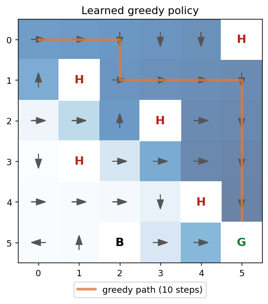
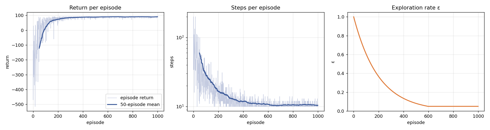
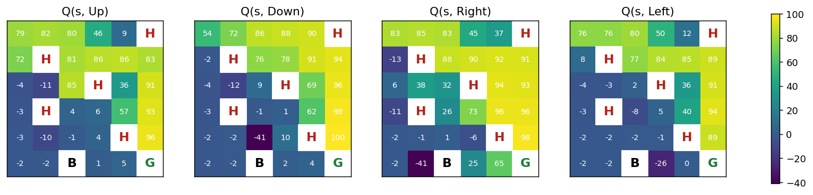

# Grid-world Q-learning

[](https://github.com/dhruvilkatharotiya01/q_learning_dhk6365/actions/workflows/ci.yml)

A tabular **Q-learning** agent that learns to cross a 6×6 grid world with
obstacles and a black hole. The environment follows the **Gymnasium API**
(`reset`/`step` with `terminated` and `truncated`), training is reproducible
with seeds, and every run reports whether the learned policy is optimal.



## The environment

| Cell | Effect |
|---|---|
| Start (0, 0) | top-left corner |
| Goal **G** (5, 5) | +100, episode ends |
| Obstacle **H** (5 cells) | −10, the agent bounces back to where it was |
| Black hole **B** (5, 2) | −50, episode ends |
| Any other move | −1, so shorter paths score higher |

Actions are up, down, right and left; moving into a wall leaves the agent in
place. Episodes are truncated after 200 steps. The shortest safe path has 10
steps (return 91), found by breadth-first search and used as ground truth.

## Q-learning

The agent keeps a table `Q[row, col, action]` and updates it after every step:

```
Q(s, a) ← Q(s, a) + α · ( r + γ · max_a' Q(s', a') − Q(s, a) )
```

with no bootstrapping from terminal states. Exploration is ε-greedy, with ε
decaying from 1.0 by a factor of 0.995 per episode down to 0.05; ties between
equal Q-values are broken randomly.

## Results

Default run (`python main.py`: 1000 episodes, α = 0.1, γ = 0.99, seed 0):

- the greedy policy follows the optimal 10-step path (return 91)
- it becomes optimal and stays optimal from episode 70 on
- in the last 100 episodes, with ε = 0.05 still exploring, the agent reaches
  the goal in 100 % of episodes, with a mean return of 89.6



**Effect of the learning rate** (`python main.py --sweep`: 5 seeds per value,
greedy policy checked every 10 episodes):

| α | optimal policy | converged at episode (median) | goal rate, last 100 episodes |
|---|---|---|---|
| 0.01 | 5/5 | 610 | 100 % |
| 0.05 | 5/5 | 130 | 100 % |
| 0.1 | 5/5 | 60 | 100 % |
| 0.3 | 5/5 | 20 | 100 % |
| 0.5 | 5/5 | 20 | 99.4 % |

All learning rates eventually find the optimal path, but α = 0.01 needs about
ten times more episodes than α = 0.1. Very high rates converge fastest here
because the environment is deterministic; with noisy transitions or rewards
they would make the Q-values oscillate.

Q-values per action (G = goal, H = obstacle, B = black hole):



## Run it

```bash
python -m venv .venv && source .venv/bin/activate
pip install -r requirements.txt

python main.py                         # train, print a summary, write results/
python main.py --alpha 0.3 --episodes 300 --seed 1
python main.py --sweep                 # learning-rate comparison
python main.py --render                # watch the learned policy (pygame window)
```

Tests: `pip install -r requirements-dev.txt && python -m pytest -q`

## Project layout

```
gridworld/env.py         environment (Gymnasium API, pure NumPy; Gymnasium optional)
gridworld/q_learning.py  training loop, greedy rollout, BFS optimum
gridworld/plots.py       training curves, Q-value heatmaps, policy plot
gridworld/render.py      optional pygame rendering with the sprites in assets/
main.py                  command line interface
tests/                   environment dynamics, learning, CLI
docs/original-trials/    plots from my first experiments
```

## Background

This started as a reinforcement-learning assignment at university. I later
restructured it: the environment moved to the current Gymnasium API with
episode truncation and runs without a display, rendering became optional,
training became seeded and reproducible, and I added the optimality check,
the learning-rate study, plots saved to files, and tests with CI.
